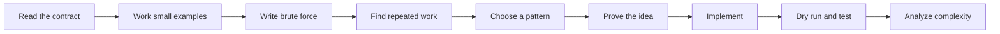

# DSA Fundamentals

## Learning Objectives

By the end of this topic, you should understand:

- what data structures and algorithms are, and why they are studied together
- how the same data can be organized in different ways
- how to choose a structure based on the operations a problem needs
- how to describe an algorithm before writing code
- how to trace an algorithm by hand with a dry run
- how to reason about time and space complexity instead of memorizing Big-O labels
- how input size and constraints influence a practical solution
- how to recognize common problem-solving patterns
- how to turn an algorithm into visualization steps for a NestJS backend

## Prerequisites

- the language syntax covered in `0-js-ts-refresher.md` — read it first if any TypeScript in this curriculum looks unfamiliar
- TypeScript variables, functions, loops, arrays, and objects
- basic conditionals such as `if` and `else`
- the idea that a function receives input and returns output
- willingness to write down intermediate state instead of solving everything mentally

You do **not** need prior knowledge of Big-O notation, recursion, trees, graphs, or interview patterns.

## Core Theory

### What does DSA mean?

**DSA** stands for **Data Structures and Algorithms**.

- A **data structure** is a way to organize data so useful operations are possible.
- An **algorithm** is a finite, ordered set of steps that transforms input into output.

Imagine a kitchen:

- The drawers, shelves, jars, and refrigerator are data structures.
- A recipe is an algorithm.

The recipe can be correct but still frustrating if every ingredient is stored in a random place. Likewise, well-organized ingredients do not prepare a meal by themselves. Organization and procedure work together.

```text
Input data
    |
    v
+-------------------+
|  Data structure   |  How is the data organized?
+-------------------+
    |
    v
+-------------------+
|     Algorithm     |  Which steps process it?
+-------------------+
    |
    v
Output
```

### Why do data structures exist?

Programs repeatedly perform operations such as:

- read an item
- search for an item
- add an item
- remove an item
- find the smallest or largest item
- process items in a particular order
- represent relationships between items

No single organization makes every operation equally fast.

Consider a list of contacts:

```text
Organization A: arrival order

[Mina, Kai, Asha, Leo]

Organization B: lookup by phone number

555-0101 -> Mina
555-0102 -> Asha
555-0103 -> Leo
555-0104 -> Kai
```

Organization A naturally preserves order. Organization B naturally supports direct lookup by a known key. The "best" structure depends on what the program does most often.

### Why do algorithms exist?

A computer needs exact instructions. "Find a useful result" is a goal, not an algorithm.

An algorithm makes the process precise:

```text
Vague goal:
Find whether 12 is in the list.

Algorithm:
1. Start at the first value.
2. Compare the current value with 12.
3. If they match, return true.
4. Otherwise move to the next value.
5. If no values remain, return false.
```

A useful algorithm has five properties:

| Property | Meaning |
|---|---|
| Input | The values it is allowed to receive are clear. |
| Output | The result it must produce is clear. |
| Precision | Each step is unambiguous. |
| Termination | The steps eventually stop. |
| Correctness | The result satisfies the problem for every valid input. |

### What problem does DSA solve?

DSA helps answer three different questions:

1. **Correctness:** Does the solution always produce the right answer?
2. **Efficiency:** How does the work grow as the input grows?
3. **Communication:** Can another person understand and verify the reasoning?

A solution must be correct before its speed matters. A fast wrong answer is still wrong.

### When should I use DSA thinking?

Use DSA thinking when:

- input can become large
- a task runs frequently
- response time or memory use matters
- data has meaningful order, hierarchy, priority, or connections
- a direct implementation repeats work
- you need to explain why a solution will scale

Examples include API request handling, database indexing, route planning, autocomplete, caching, scheduling, and recommendation systems.

### When should I not over-optimize?

Do not replace clear code with a complicated algorithm merely because it has a better Big-O label.

A simple solution may be the responsible choice when:

- the input is permanently tiny
- the code is rarely executed
- network or database latency dominates the runtime
- the optimized version adds significant correctness risk
- profiling shows that this code is not a bottleneck

DSA gives you better choices. It does not require choosing the most complicated option.

### What does data look like internally?

At the lowest level, a computer stores values in memory. A data structure defines how those values relate to one another and how the program reaches them.

#### Contiguous organization

Array elements are conceptually stored next to one another:

```text
Index:     0       1       2       3
        +-------+-------+-------+-------+
Value:  |  10   |  20   |  30   |  40   |
        +-------+-------+-------+-------+
```

Knowing an index lets the program jump to that position directly.

#### Linked organization

A linked list node stores a value and a reference to another node:

```text
+---------+      +---------+      +---------+
| 10 | o--+----->| 20 | o--+----->| 30 | / |
+---------+      +---------+      +---------+
   head                                  null
```

The nodes do not need to be next to one another, but reaching a later node requires following links.

#### Keyed organization

A map connects a key to a value:

```text
Key       Value
----------------
"red"  -> 3
"blue" -> 7
"gold" -> 2
```

The key is used to locate its associated value without intentionally scanning every stored pair.

#### Hierarchical organization

A tree represents parent-child relationships:

```text
             root
            /    \
       child A  child B
        /   \
   child C  child D
```

File systems, organization charts, and syntax trees have this kind of shape.

#### Network organization

A graph represents items and their connections:

```text
    A ----- B
    |       |
    |       |
    C ----- D ----- E
```

Cities and roads, users and friendships, and services and dependencies can all be modeled as graphs.

### Data structure versus data type

A **data type** describes which values and operations are valid. A **data structure** describes how data is arranged to support operations.

For example, TypeScript's `number` is a type. An array of numbers is a structure that stores many number values in order.

### Interface versus implementation

An **interface** describes what a structure can do. An **implementation** describes how it does it.

A queue's interface might be:

```text
enqueue(value)  Add a value at the back
dequeue()       Remove a value from the front
peek()          Read the front value
```

The queue could be implemented with an array or a linked list. The behavior stays first-in, first-out even though the internal representation changes.

```text
Interface: what users can ask for
                 |
                 v
Implementation: how the request is carried out
```

This distinction matters in interviews and production code. First decide which behavior the problem needs. Then choose an implementation with suitable costs.

### Essential vocabulary

| Term | Beginner-friendly meaning |
|---|---|
| Element | One value inside a collection. |
| Index | A numeric position, usually starting at `0`. |
| Node | A container holding a value and one or more references. |
| Edge | A connection between two graph nodes. |
| Key | A value used to look up another value. |
| Traverse | Visit items in a deliberate order. |
| Iterate | Repeat steps, commonly with a loop. |
| Mutable | Allowed to change after creation. |
| Immutable | Not changed after creation; a new value is created instead. |
| In place | Modify the input while using little or no extra storage that grows with input size. |
| Stable | Preserve the relative order of items considered equal. |
| Constraint | A limit on valid input, such as array length. |
| Invariant | A fact that remains true while an algorithm runs. |

### Correctness: preconditions, postconditions, and invariants

Correctness becomes easier to discuss when the contract is explicit.

- A **precondition** must be true before the algorithm starts.
- A **postcondition** must be true when it finishes.
- An **invariant** remains true at a chosen point during every step.

Example for summing an array:

```text
Precondition:
Every array element is a finite number.

Invariant before processing index i:
sum equals the total of elements from index 0 through i - 1.

Postcondition:
sum equals the total of every array element.
```

The invariant explains why the loop works, not just what its code looks like.

### Mutation and side effects

Some algorithms change their input. Others return a new value and leave the input unchanged.

```typescript
const original = [3, 1, 2];

original.sort((left, right) => left - right); // Mutates original

const source = [3, 1, 2];
const sortedCopy = [...source].sort((left, right) => left - right);
```

Mutation can save space, but callers may be surprised if their data changes. State the choice in the function contract.

## Visual Mental Model

### The toolbox model

Think of data structures as tools. A tool is useful because of the operation it makes easy.

| Need | Likely tool | Mental picture |
|---|---|---|
| Read by position | Array | Numbered lockers |
| Look up by key | Map | Dictionary index |
| Membership only | Set | Guest list |
| Last item added comes out first | Stack | Stack of plates |
| First item added comes out first | Queue | People in a line |
| Repeatedly get highest priority | Heap | Emergency priority desk |
| Parent-child relationships | Tree | Folder hierarchy |
| General connections | Graph | Cities and roads |

This is not a rule that chooses the answer automatically. It is a shortlist based on the operations named by the problem.

### Follow one value through an algorithm

Suppose an algorithm doubles each value:

```text
Input             Current work              Output

[2, 5, 8]    ->   read 2, calculate 4   ->   [4]
[2, 5, 8]    ->   read 5, calculate 10  ->   [4, 10]
[2, 5, 8]    ->   read 8, calculate 16  ->   [4, 10, 16]
```

A visualization should reveal:

- what has already been processed
- what is being processed now
- what remains
- which state changed
- why the next step is valid

### State is the algorithm's memory

An algorithm's **state** is the information it must remember between steps.

```text
Loop position: index = 2
Running total: sum = 11
Best seen:     maximum = 7
Lookup data:   seen = {3, 7}
```

When a solution feels mysterious, write down its state. If you cannot name what changes after one step, the idea is not yet precise enough to code.

### A problem-solving pipeline



Do not skip directly from reading the prompt to typing code. Small examples and brute force expose assumptions that code can hide.

## Complexity Concepts

### What is complexity?

Complexity describes how an algorithm's resource use grows as its input grows.

The two main resources are:

- **Time complexity:** growth in the amount of work
- **Space complexity:** growth in the amount of extra memory

Complexity is not a stopwatch measurement. A machine, language, and runtime affect seconds. Complexity focuses on the growth pattern.

### What does `n` mean?

`n` represents an input size chosen for the problem.

Examples:

| Problem | A sensible meaning of `n` |
|---|---|
| Search an array | Number of array elements |
| Process a string | Number of characters |
| Traverse a tree | Number of nodes |
| Explore a graph | Often vertices `V` and edges `E` |
| Compare two arrays | Their separate lengths, often `n` and `m` |

Always define `n`. Otherwise, `O(n)` has no precise meaning.

### What is Big-O?

Big-O describes an upper growth rate as input becomes large. In typical interview analysis, it communicates the dominant growth of time or extra space.

If a loop performs approximately `3n + 5` basic operations:

```text
small fixed work       repeated work
       5          +         3n
```

As `n` grows, the linear term matters most. Big-O ignores the constant multiplier and lower-growth terms:

```text
3n + 5
   |
   +-- dominant growth is n

Time complexity = O(n)
```

This does **not** mean constants never matter in real programs. It means Big-O answers a particular question about growth.

### Common growth rates

| Complexity | Name | Typical example |
|---:|---|---|
| `O(1)` | Constant | Read an array element by index |
| `O(log n)` | Logarithmic | Binary search in sorted data |
| `O(n)` | Linear | Visit every array element once |
| `O(n log n)` | Linearithmic | Efficient comparison sorting |
| `O(n^2)` | Quadratic | Compare every pair of values |
| `O(2^n)` | Exponential | Explore every include/exclude choice |
| `O(n!)` | Factorial | Generate every ordering |

For an input of size `16`, the rough growth looks like this:

```text
O(1)          1 operation unit
O(log n)      4 operation units
O(n)         16 operation units
O(n log n)   64 operation units
O(n^2)      256 operation units
O(2^n)   65,536 operation units
```

These are teaching approximations, not exact runtime counts.

### `O(1)`: constant time

```typescript
function firstValue(values: number[]): number | undefined {
  return values[0];
}
```

Whether the array contains 3 values or 3 million, the function performs one indexed read.

```text
n = 3         -> 1 indexed read
n = 3,000,000 -> 1 indexed read

Time = O(1)
```

### `O(n)`: linear time

```typescript
function contains(values: number[], target: number): boolean {
  for (const value of values) {
    if (value === target) {
      return true;
    }
  }

  return false;
}
```

In the worst case, the target is absent or last. The loop checks all `n` values.

```text
n values -> at most n comparisons

Time = O(n)
```

### `O(n^2)`: quadratic time

```typescript
function printAllPairs(values: number[]): void {
  for (const left of values) {
    for (const right of values) {
      console.log(left, right);
    }
  }
}
```

For every one of `n` outer iterations, the inner loop performs `n` iterations.

```text
outer work x inner work
     n     x     n
           = n^2

Time = O(n^2)
```

Doubling the input makes the pair count roughly four times larger.

### `O(log n)`: logarithmic time

An algorithm is often logarithmic when each step discards a fixed fraction of the remaining possibilities.

Binary search discards half:

```text
16 candidates
      |
      v
 8 candidates
      |
      v
 4 candidates
      |
      v
 2 candidates
      |
      v
 1 candidate
```

It took 4 halvings to reduce 16 to 1. Because `2^4 = 16`, the number of halvings is `log2(16)`.

```text
n -> n/2 -> n/4 -> n/8 -> ... -> 1

Time = O(log n)
```

### `O(n log n)`: repeated logarithmic work

Efficient comparison sorts commonly perform `log n` levels of work, with about `n` total work at each level.

```text
Level 0: n total items of work
Level 1: n total items of work
Level 2: n total items of work
...
log n levels

n work per level x log n levels = O(n log n)
```

### Exponential and factorial growth

Some algorithms explore combinations or orderings.

For `n` independent yes/no choices:

```text
choice 1: include / exclude
choice 2: include / exclude
...
choice n: include / exclude

2 x 2 x ... x 2 = 2^n possibilities
```

For every ordering of `n` distinct values:

```text
n choices for first position
n - 1 choices for second
n - 2 choices for third
...
1 choice for last

n x (n - 1) x ... x 1 = n! possibilities
```

These costs become large quickly. Later, backtracking chapters will show how constraints and pruning make some such searches practical.

### Sequential work adds

If one loop processes `n` items and a later loop also processes `n` items:

```text
n + n = 2n

Drop the constant multiplier:
Time = O(n)
```

The loops are sequential, so their work adds. They are not automatically `O(n^2)` merely because there are two loops.

### Nested dependent work may form a series

Consider a triangular nested loop:

```typescript
for (let left = 0; left < values.length; left += 1) {
  for (let right = left + 1; right < values.length; right += 1) {
    console.log(values[left], values[right]);
  }
}
```

The inner work shrinks:

```text
(n - 1) + (n - 2) + ... + 2 + 1
= n(n - 1) / 2
= (n^2 - n) / 2

Dominant growth = n^2
Time = O(n^2)
```

### Separate inputs need separate variables

```typescript
function printCrossProduct(left: number[], right: number[]): void {
  for (const leftValue of left) {
    for (const rightValue of right) {
      console.log(leftValue, rightValue);
    }
  }
}
```

If `left` has `n` items and `right` has `m` items, the work is:

```text
n outer iterations x m inner iterations
= O(nm)
```

Calling this `O(n^2)` incorrectly assumes both inputs always have the same length.

### Best, average, and worst case

For linear search:

- Best case: the target is first, so one comparison gives `O(1)`.
- Worst case: the target is last or absent, so `n` comparisons give `O(n)`.
- Average case: depends on how inputs and target positions are distributed.

Unless a problem says otherwise, interviews commonly expect worst-case complexity. State which case you are analyzing.

### Space complexity

Space complexity measures how memory use grows with input size.

```typescript
function doubleValues(values: number[]): number[] {
  const doubled: number[] = [];

  for (const value of values) {
    doubled.push(value * 2);
  }

  return doubled;
}
```

The result stores `n` numbers:

```text
n input values -> n output values

Output space = O(n)
```

Often an interviewer asks for **auxiliary space**, meaning extra working memory besides the required input and output. In this example, loop variables use constant auxiliary space, but the returned output uses `O(n)` space. State which definition you are using.

### In-place does not mean zero memory

An in-place algorithm usually uses only a constant amount of extra memory that does not grow with `n`.

```text
Input array: O(n) existing storage
Temporary variable: O(1) extra storage

Auxiliary space = O(1)
```

The input still occupies memory. "In place" describes additional storage and mutation behavior.

### Recursion uses stack space

Each unfinished recursive call occupies a call-stack frame.

```text
call(4)
  call(3)
    call(2)
      call(1)
```

If the maximum recursive depth is `n`, the call stack uses `O(n)` auxiliary space even when no array or map is created.

### Amortized complexity

Some operations are occasionally expensive but cheap on average over a sequence.

A dynamic array may need to allocate a larger internal area and copy existing elements when capacity is full:

```text
Capacity 4 is full:

[A][B][C][D]

Allocate larger capacity and copy:

[A][B][C][D][ ][ ][ ][ ]
```

Most appends take constant time. Rare resizing operations take linear time. Spread across many appends, the average cost per append is **amortized `O(1)`**.

### Constraints guide the solution

Input limits help rule approaches in or out. A rough interview guide is:

| Maximum input size | Often worth considering |
|---:|---|
| `n <= 10` | Factorial or exponential search may be possible |
| `n <= 20` | Some `O(2^n)` approaches may be possible |
| `n <= 1,000` | `O(n^2)` may be possible |
| `n <= 100,000` | Usually aim for `O(n log n)` or `O(n)` |
| `n >= 1,000,000` | Usually near-linear; memory also matters |

These are estimates, not laws. Language, constants, time limits, input shape, and server load all matter.

### TypeScript operations have costs too

Do not assume every built-in method is constant time.

| TypeScript operation | Typical cost | Why |
|---|---:|---|
| `array[index]` | `O(1)` | Direct positional access |
| `array.push(value)` | Amortized `O(1)` | Usually append; occasional resize |
| `array.pop()` | `O(1)` | Remove from the end |
| `array.shift()` | `O(n)` | Remaining items are re-indexed |
| `array.unshift(value)` | `O(n)` | Existing items move right |
| `array.includes(value)` | `O(n)` | May scan the whole array |
| `map.get(key)` | Average `O(1)` | Hash-based key lookup |
| `set.has(value)` | Average `O(1)` | Hash-based membership lookup |
| `array.sort(compareFn)` | Commonly `O(n log n)` | Sorting compares and rearranges values |
| `[...array]` | `O(n)` | Copies all elements |

JavaScript engines determine exact implementation details. These costs are the practical models used for algorithm reasoning.

### Complexity is one part of engineering

Compare two correct solutions:

```text
Solution A
Time:  O(n)
Space: O(n)

Solution B
Time:  O(n log n)
Space: O(1)
```

Neither is universally better. The choice depends on:

- input size
- memory limits
- whether mutation is allowed
- implementation risk
- expected request volume
- readability and maintenance

Explain the tradeoff instead of declaring a winner without context.

## Common Patterns

Patterns are reusable shapes of reasoning. They are not code templates to apply blindly.

### Traversal and accumulation

Visit every item and update a small piece of state.

```text
[4, 2, 7, 1]
 ^
 read -> update state -> move
```

Recognize it when the problem asks for a count, sum, minimum, maximum, or validation across all values.

### Hash-based lookup

Store previously seen information in a `Map` or `Set` to avoid repeated scanning.

```text
Repeated scan: "Have I seen 7?" -> inspect old values again

Set lookup:    "Have I seen 7?" -> seen.has(7)
```

Recognize it when the problem asks about duplicates, frequencies, complements, grouping, or membership.

### Two pointers

Maintain two positions that move according to an invariant.

```text
[1, 3, 4, 6, 8, 10]
 ^                 ^
left             right
```

Recognize it in sorted pair problems, reversing, partitioning, or comparing values from opposite ends.

### Sliding window

Maintain a contiguous range and update it as the boundaries move.

```text
[2, 1, 5, 1, 3, 2]
    [-------]
      window
```

Recognize it when the problem asks about a contiguous substring or subarray and repeated ranges share most of their elements.

### Prefix information

Precompute information about everything before each position so a later range query can reuse it.

```text
values:  [2, 4, 1, 3]
prefix:  [0, 2, 6, 7, 10]
```

Recognize it when many range totals are requested or a subarray condition can be rewritten using earlier cumulative values.

### Divide and conquer

Split a problem into smaller versions, solve them, and combine the results.

```text
             whole problem
              /          \
         left half     right half
           /  \          /  \
        smaller parts  smaller parts
```

Recognize it when halves can be processed mostly independently, as in merge sort and binary search.

### Fast and slow pointers

Move one pointer faster than another through linked data.

```text
slow:  one step at a time
fast:  two steps at a time
```

Recognize it in linked-list cycle detection and middle-node problems.

### Stack-based processing

Remember unfinished work in last-in, first-out order.

```text
+-------+
| task C| <- next
+-------+
| task B|
+-------+
| task A|
+-------+
```

Recognize it with nested delimiters, undo behavior, expression parsing, and "next greater" problems.

### Breadth-first and depth-first traversal

- **Breadth-first search (BFS)** explores one distance level at a time, usually with a queue.
- **Depth-first search (DFS)** follows one path deeply before returning, using recursion or a stack.

```text
        A
       / \
      B   C
     / \   \
    D   E   F

BFS: A, B, C, D, E, F
DFS example: A, B, D, E, C, F
```

Recognize them when data forms a tree or graph and the task requires visiting reachable nodes.

### Pattern recognition checklist

Before choosing a pattern, ask:

1. Is the data sorted?
2. Is the answer about a contiguous range?
3. Do I repeatedly ask whether something was seen?
4. Do I repeatedly calculate information for overlapping ranges?
5. Is there a hierarchy or network to traverse?
6. Does the problem require first-in-first-out or last-in-first-out order?
7. Can I discard a fixed fraction of candidates each step?
8. What fact must remain true while pointers or boundaries move?

---

# Problems

The official set of 200 interview questions begins in `01-arrays.md`. This fundamentals chapter does not add to or renumber that set. The following unnumbered guided lab exists only to practice the reasoning process used in every later topic.

## Guided Lab - Count Values Above a Threshold

### 1. Problem Statement

Given an array of numbers and a threshold, return how many values are strictly greater than the threshold.

### 2. Example

```text
Input:
values = [4, 9, 2, 9, 6]
threshold = 5

Output:
3

Explanation:
9, 9, and 6 are greater than 5.
```

### 3. Understand the Problem

The function returns a count, not the matching values or their indexes.

"Strictly greater" means a value equal to the threshold does not count.

Before coding, clarify the contract:

- Input: an array of finite numbers and one finite threshold
- Output: a non-negative integer
- Empty input: returns `0`
- Mutation: the input array must remain unchanged

### 4. Real-World Analogy

Imagine checking ride tickets at an amusement park. Each ticket shows a rider's height, and the ride requires a height greater than a given limit. You inspect each ticket once and increase a counter whenever the height passes the rule.

### 5. Key Observation

Every value can independently affect the answer. If an uninspected value is greater than the threshold, skipping it would make the count wrong.

Therefore, the algorithm must inspect every value at least once in the general case.

### 6. Pattern

```text
Pattern: Traversal and accumulation
```

This pattern applies because:

- every array element must be visited
- each element is checked with the same rule
- a single counter summarizes all earlier results

Recognize this pattern in problems asking to count, sum, validate, or select items based on a condition.

Similar problems include counting even numbers, summing positive values, and checking whether every value satisfies a rule.

### 7. Brute Force

The most direct approach is:

1. Start a counter at `0`.
2. Visit each value.
3. If the value is greater than the threshold, increase the counter.
4. Return the counter.

#### Pseudocode

```text
count = 0

for each value in values
    if value > threshold
        count = count + 1

return count
```

#### Visualization

```text
values:    [4, 9, 2, 9, 6]
threshold: 5

Start: count = 0

4 > 5? no   -> count = 0
9 > 5? yes  -> count = 1
2 > 5? no   -> count = 1
9 > 5? yes  -> count = 2
6 > 5? yes  -> count = 3
```

#### Dry Run

| Step | Current value | Is value > 5? | Count after step |
|---:|---:|:---:|---:|
| Start | - | - | 0 |
| 1 | 4 | No | 0 |
| 2 | 9 | Yes | 1 |
| 3 | 2 | No | 1 |
| 4 | 9 | Yes | 2 |
| 5 | 6 | Yes | 3 |

#### Brute-Force Complexity

There are `n` values. The algorithm makes one comparison for each value:

```text
1 comparison x n values = n comparisons

Time = O(n)
```

The counter and current loop value occupy a fixed amount of memory regardless of `n`:

```text
fixed working variables

Auxiliary space = O(1)
```

### 8. Why Brute Force Is Not Ideal

In many problems, brute force repeats work and can be improved. Here, the direct approach does **not** repeat work.

Any correct general solution must inspect every element because any unseen element might pass the threshold. The brute-force approach is already asymptotically optimal.

This is an important lesson: do not force an optimization when the lower bound already matches the solution.

### 9. Optimal Approach

Use the same single traversal. It performs the minimum necessary inspection and stores only the running count.

Sorting first would not help:

- sorting costs approximately `O(n log n)` time
- sorting may mutate the input
- one traversal already solves the task in `O(n)` time

A `filter` call could express the condition concisely, but it usually creates a new array of matching values. A counter uses less additional memory.

### 10. Visualization

The invariant is:

> Before each step, `count` equals the number of processed values that are greater than the threshold.

```text
Processed          Current          Unprocessed       count
---------          -------          -----------       -----
[]                    4             [9, 2, 9, 6]        0
[4]                   9             [2, 9, 6]           0
[4, 9]                2             [9, 6]              1
[4, 9, 2]             9             [6]                 1
[4, 9, 2, 9]          6             []                  2
[4, 9, 2, 9, 6]       -             []                  3
```

At termination, every value is processed. The invariant then tells us that `count` describes the entire array.

### 11. Step-by-Step Dry Run

Use an example containing a value equal to the threshold:

```text
Input:
values = [7, 3, 7, 10]
threshold = 7
```

```text
Step 1
current value = 7
7 > 7 is false because equality does not count
count remains 0

Step 2
current value = 3
3 > 7 is false
count remains 0

Step 3
current value = 7
7 > 7 is false
count remains 0

Step 4
current value = 10
10 > 7 is true
count becomes 1

Answer: 1
```

### 12. TypeScript Solution

```typescript
function countAboveThreshold(values: number[], threshold: number): number {
  let count = 0;

  for (const value of values) {
    if (value > threshold) {
      count += 1;
    }
  }

  return count;
}
```

### 13. Code Walkthrough

```typescript
let count = 0;
```

No values have been processed, so zero qualifying values have been found.

```typescript
for (const value of values) {
```

The loop visits each array element exactly once. `value` is the current item in the visualization.

```typescript
if (value > threshold) {
  count += 1;
}
```

The condition matches "strictly greater" in the contract. The count changes only when the current value qualifies.

```typescript
return count;
```

Once the loop ends, no values remain unprocessed, so the invariant proves that `count` is the required answer.

### 14. Complexity Analysis

**Time Complexity: `O(n)`**

Let `n` be the number of values. The loop processes all `n` values, and each iteration performs constant work: one comparison and, sometimes, one increment.

```text
n iterations x O(1) work per iteration
= O(n)
```

There is no correct sublinear general solution because an unchecked value could change the answer.

**Space Complexity: `O(1)` auxiliary space**

The algorithm stores only `count` and the current `value`. The number of working variables does not grow when the input grows.

The input itself uses `O(n)` storage, but it already exists and is not created by this function.

### 15. Edge Cases

- `[]` returns `0` because no values qualify.
- `[5]` with threshold `5` returns `0` because the comparison is strict.
- `[-3, -1]` with threshold `-2` returns `1`; negative values follow normal numeric comparison.
- `[8, 8, 8]` with threshold `2` returns `3`; duplicates count separately.
- A very large array still requires one pass and constant auxiliary space.

`NaN` and infinite values are excluded by this lab's finite-number precondition. A production API should validate that precondition at its boundary.

### 16. Common Mistakes

- Using `>=` instead of `>` and incorrectly counting values equal to the threshold.
- Returning the matching values when the problem asks for their count.
- Starting `count` at `1`, which assumes a match before checking anything.
- Sorting the array even though order is irrelevant.
- Calling this `O(1)` because only one counter is stored; that confuses space complexity with time complexity.
- Calling this `O(n^2)` because comparison and increment both happen inside a loop; sequential constant operations do not create another factor of `n`.

### 17. Interview Follow-ups

1. How would the solution change if values equal to the threshold should count?
2. How would you return both the count and matching indexes?
3. Can the array be processed as a stream instead of being stored completely?
4. How would you answer many different threshold queries against the same unchanging array?
5. How would invalid values such as `NaN` be handled in a production API?

### 18. Variations

- Count values inside an inclusive range.
- Count values that satisfy a callback predicate.
- Return the percentage of values above the threshold.
- Process values arriving one at a time from a stream.
- Pre-sort static data so many threshold queries can use binary search.

The final variation changes the tradeoff. One query favors a linear scan. Many queries may justify preprocessing.

### 19. Pattern Connections

Traversal and accumulation appears in:

- finding a minimum or maximum
- counting frequencies
- checking whether an array is sorted
- computing a running sum
- counting tree nodes with DFS
- counting connected components in a graph

The collection shape changes, but the core idea remains: visit an item, update state, continue.

### 20. NestJS Project Connection

A DSA Lab backend could expose:

```text
POST /api/dsa/fundamentals/count-above-threshold
```

Example request:

```json
{
  "values": [4, 9, 2, 9, 6],
  "threshold": 5,
  "includeSteps": true
}
```

Example response:

```json
{
  "result": 3,
  "complexity": {
    "time": "O(n)",
    "auxiliarySpace": "O(1)"
  },
  "steps": [
    { "index": 0, "value": 4, "matched": false, "count": 0 },
    { "index": 1, "value": 9, "matched": true, "count": 1 },
    { "index": 2, "value": 2, "matched": false, "count": 1 },
    { "index": 3, "value": 9, "matched": true, "count": 2 },
    { "index": 4, "value": 6, "matched": true, "count": 3 }
  ]
}
```

The service should separate calculation from HTTP concerns:

```text
Controller
  validates and accepts the request
       |
       v
Service
  runs the algorithm and records optional steps
       |
       v
Response DTO
  returns result, complexity, and visualization state
```

For large inputs, `includeSteps` should default to `false` or enforce a limit. Recording one object per element changes visualization storage from `O(1)` auxiliary space to `O(n)`. The algorithm itself has not changed, but observability has a memory cost.

### 21. Mini Challenge

Change the function so it returns an object with three counts:

```typescript
type ThresholdCounts = {
  below: number;
  equal: number;
  above: number;
};
```

Try to solve it with one traversal and constant auxiliary space. Before coding, write the invariant that should be true after each processed value.

---

# Problem-Solving Workflow

Use this process for every later question.

## 1. Restate the contract

Write down:

- exact input and output
- whether order matters
- whether duplicates are allowed
- whether input may be empty
- whether input may be mutated
- expected behavior for invalid input

If you cannot restate the task in plain language, do not code yet.

## 2. Work through tiny examples

Use examples small enough to solve by hand:

```text
empty input
one item
two items
duplicates
negative values
already organized input
```

Only choose cases relevant to the problem. Tiny examples reveal hidden assumptions quickly.

## 3. Write brute force first

Ask: "What is the most direct correct procedure?"

Brute force provides:

- a correctness baseline
- a way to generate expected outputs for tests
- a place to identify repeated work
- a fallback when constraints are small

Do not confuse simple with bad. The guided lab's direct solution was already optimal.

## 4. Find the expensive work

Mark what repeats:

```text
Do we scan the same range again?
Do we search old values repeatedly?
Do we sort only to find one value?
Do we calculate the same state more than once?
```

Optimization usually replaces repeated work with stored information, ordered movement, or a mathematical observation.

## 5. State the key observation

Write one sentence connecting the problem to the improvement.

Example:

```text
Because the array is sorted, if the middle value is too small,
every value to its left is also too small.
```

That sentence is the reason binary search may discard half the candidates. Without the observation, the code is only memorized movement.

## 6. Choose state and an invariant

List each variable and what it means:

```text
left    = first possible index
right   = last possible index
best    = best valid answer seen so far
seen    = values processed earlier
```

Then state what remains true after every iteration. This catches pointer updates that skip valid answers.

## 7. Write pseudocode

Pseudocode should describe decisions without language syntax getting in the way.

```text
initialize state

while work remains
    inspect current item
    update answer state
    move to next state

return answer
```

If the pseudocode is confused, TypeScript will only make the confusion executable.

## 8. Dry run before implementation

Create a table showing only state that matters:

| Step | Current input | Important state | Decision |
|---:|---|---|---|
| 1 | ... | ... | ... |
| 2 | ... | ... | ... |

Include a normal case and an edge case. Confirm that the loop starts, progresses, and terminates.

## 9. Implement readable TypeScript

Prefer:

- descriptive names
- explicit return types
- small, focused functions
- standard control flow
- mutation only when the contract allows it

Avoid clever expressions that hide state transitions. Interview code is communication as well as execution.

## 10. Verify and analyze

Check:

- Does output match every example?
- Does the algorithm terminate?
- Does it preserve its invariant?
- What operation dominates time growth?
- Which new storage grows with input?
- Did a helper such as sorting, slicing, spreading, or queue shifting add hidden cost?

## Testing Fundamentals

Examples demonstrate behavior. Tests systematically check it.

### A focused test table

| Test category | Purpose |
|---|---|
| Normal case | Confirm expected everyday behavior |
| Smallest valid input | Reveal initialization errors |
| Boundary values | Check strict versus inclusive conditions |
| Duplicate values | Check whether occurrences are handled separately |
| Negative values | Reveal assumptions about signs |
| Large input | Expose scaling or stack-depth problems |

### Example tests for the guided lab

```typescript
console.assert(countAboveThreshold([4, 9, 2], 5) === 1);
console.assert(countAboveThreshold([], 5) === 0);
console.assert(countAboveThreshold([5], 5) === 0);
console.assert(countAboveThreshold([-3, -1], -2) === 1);
console.assert(countAboveThreshold([8, 8, 8], 2) === 3);
```

Tests can show that examples pass. The invariant and reasoning explain why every valid input should work.

## TypeScript Notes for DSA

### Numbers

JavaScript and TypeScript use floating-point `number` values. Integers are represented exactly only within the safe integer range:

```typescript
Number.MIN_SAFE_INTEGER;
Number.MAX_SAFE_INTEGER;
```

If exact arithmetic can exceed that range, consider `bigint` and keep all operands compatible.

### Equality

Prefer strict equality:

```typescript
left === right;
left !== right;
```

Strict equality avoids automatic type conversion.

### Sorting numbers

Provide a comparator for numeric order:

```typescript
values.sort((left, right) => left - right);
```

Without a comparator, values are sorted as strings, so `[2, 10]` may be ordered unexpectedly.

Remember that `sort` mutates the array. Use `[...values].sort(...)` when the input must remain unchanged, and count the copy as `O(n)` additional space.

### Maps and sets

Use `Map` for key-value associations and `Set` for membership:

```typescript
const frequency = new Map<number, number>();
const seen = new Set<number>();
```

Do not use a plain object automatically when keys are not naturally strings. `Map` makes key intent and size operations clearer.

### Queue caution

Repeatedly calling `shift()` on a large array can make queue processing quadratic because remaining indexes may move after every removal.

A simple indexed queue avoids front removal:

```typescript
const queue: number[] = [10];
let front = 0;

while (front < queue.length) {
  const current = queue[front];
  front += 1;

  // Process current and push newly discovered values.
}
```

This detail becomes important in breadth-first search.

## Building Visualization-Friendly Algorithms

A visualization step should record meaning, not an arbitrary copy of every local variable.

Useful fields often include:

```typescript
type ExecutionStep = {
  index: number;
  action: "inspect" | "update" | "skip";
  value: number;
  state: Record<string, unknown>;
  explanation: string;
};
```

### Keep result and tracing separable

Conceptually, prefer:

```text
algorithm input
      |
      +----> result
      |
      +----> optional step recorder
```

This allows production execution to avoid storing visualization history. It also makes the pure algorithm easier to test.

### Visualization changes complexity

An `O(1)`-space algorithm can produce `O(n)` step data if every iteration is recorded.

```text
algorithm state:       constant number of variables -> O(1)
recorded trace:        one record per input item     -> O(n)
serialized API output: one record per input item     -> O(n)
```

Always analyze the algorithm and the optional teaching trace separately.

### API safety

A NestJS endpoint for algorithm execution should consider:

- DTO validation for types and size limits
- maximum input length
- maximum recorded step count
- deterministic response shape
- request timeouts for expensive algorithms
- avoiding sensitive input in logs
- cancellation or job processing for long demonstrations

The educational API should not let a request generate unlimited work or an unlimited response.

# Topic Summary

## What You Learned

- Data structures organize values; algorithms define steps that process them.
- The right structure depends on the operations the program needs most.
- Correctness comes before optimization and can be explained with contracts and invariants.
- Big-O describes growth, not exact elapsed time.
- Time and space must be analyzed separately.
- Sequential work adds, nested independent work multiplies, and recursive depth consumes stack space.
- Brute force is a reasoning baseline and is sometimes already optimal.
- Patterns help narrow choices, but observations and invariants explain why a pattern works.
- TypeScript built-ins such as `sort`, `shift`, copying, `Map`, and `Set` have costs worth recognizing.
- Recording visualization steps can change the memory and response-size complexity of an API.

## Patterns You Should Recognize

- traversal and accumulation for processing every value once
- hash-based lookup for membership, complements, and frequencies
- two pointers for coordinated movement through ordered or partitioned data
- sliding windows for contiguous ranges with overlapping work
- prefix information for repeated range calculations
- divide and conquer for independently solvable smaller pieces
- fast and slow pointers for linked-list position and cycle questions
- stacks and queues when processing order matters
- BFS and DFS for trees and graphs

## Complexity Cheat Sheet

| Operation or shape | Time | Extra space | Reasoning cue |
|---|---:|---:|---|
| Direct indexed access | `O(1)` | `O(1)` | One position is addressed |
| Single full traversal | `O(n)` | Often `O(1)` | Visit each item once |
| Two sequential traversals | `O(n)` | Depends | `n + n = 2n` |
| Nested full traversals | `O(n^2)` | Often `O(1)` | `n x n` pairs |
| Halve candidates each step | `O(log n)` | Often `O(1)` | Number of halvings |
| `log n` levels with `n` work each | `O(n log n)` | Depends | Work per level x levels |
| Store one entry per item | Depends | `O(n)` | Storage grows with input |
| Recursion depth `n` | Depends | `O(n)` | One stack frame per level |
| Record one step per item | Adds `O(n)` work | Adds `O(n)` | Trace grows with execution |

## Common Interview Traps

- Coding before clarifying input, output, mutation, and edge cases.
- Giving a Big-O label without defining `n` or explaining the counted work.
- Multiplying sequential loops instead of adding their costs.
- Ignoring hidden costs from sorting, copying, slicing, or `shift()`.
- Forgetting recursive call-stack space.
- Calling hash lookup guaranteed `O(1)` instead of average `O(1)`.
- Optimizing a solution before proving the simple version correct.
- Applying a memorized pattern without stating the observation that makes it valid.
- Testing only the sample input.
- Mixing algorithm logic, trace generation, and HTTP concerns into one function.

## Practice Checklist

- [ ] I can explain data structure versus algorithm in my own words.
- [ ] I can choose a likely structure from the operations a problem requires.
- [ ] I can define `n` before giving a complexity.
- [ ] I can derive `O(1)`, `O(log n)`, `O(n)`, and `O(n^2)` from the work performed.
- [ ] I can distinguish input, output, and auxiliary space.
- [ ] I can include recursive stack frames in space analysis.
- [ ] I can write a brute-force approach before optimizing.
- [ ] I can identify repeated work in a simple algorithm.
- [ ] I can state an invariant for a loop.
- [ ] I can dry-run code in a table without executing it.
- [ ] I can explain why a direct solution may already be optimal.
- [ ] I can name the costs of common TypeScript array operations.
- [ ] I can separate algorithm results from visualization steps.
- [ ] I completed the Count Values Above a Threshold mini challenge.